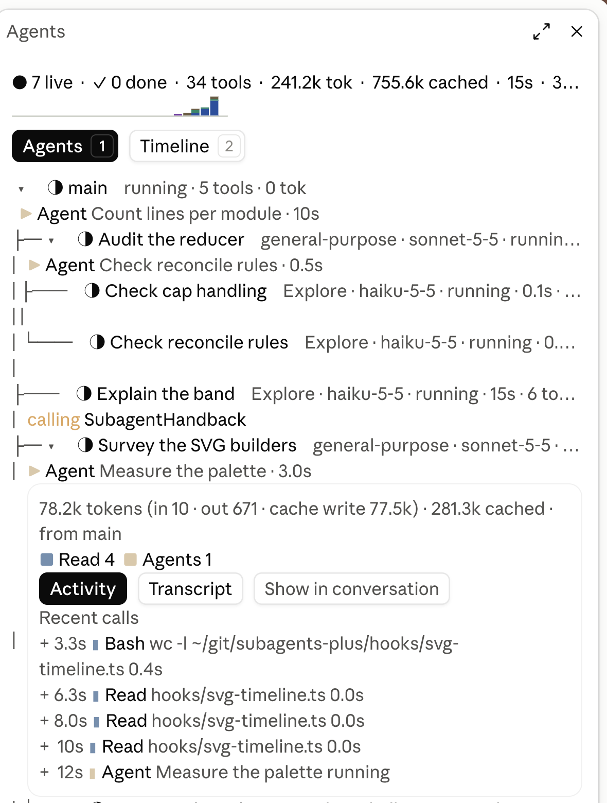
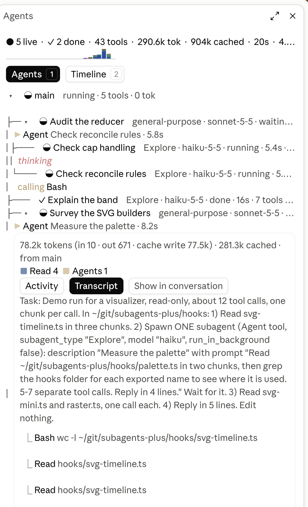
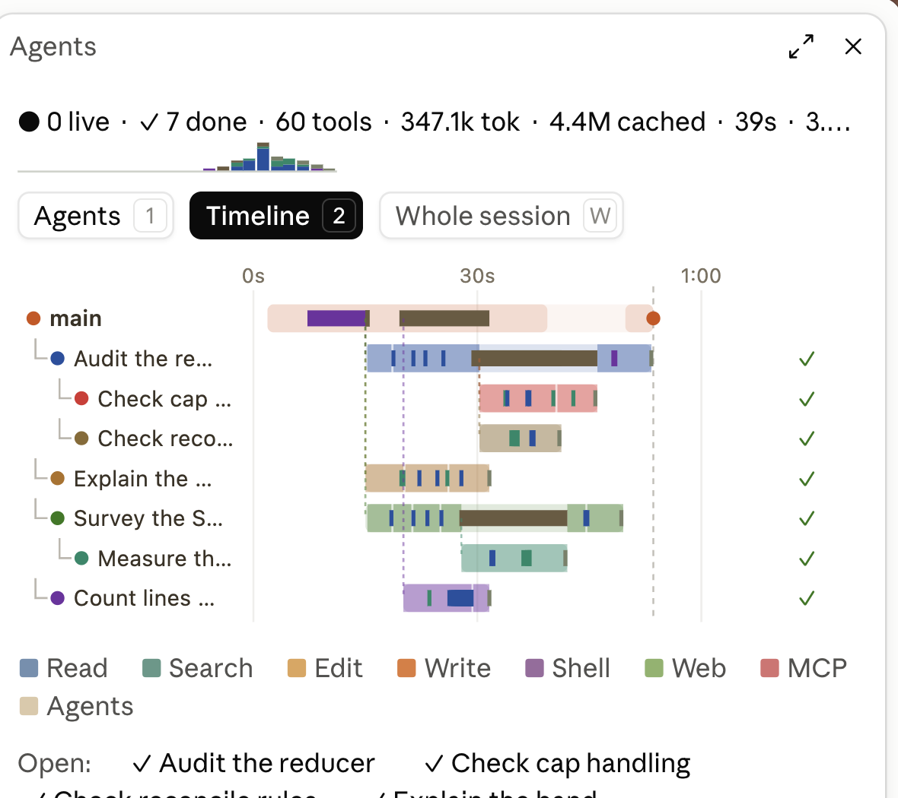
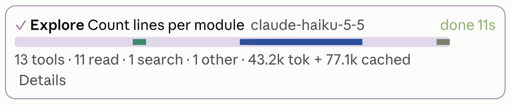
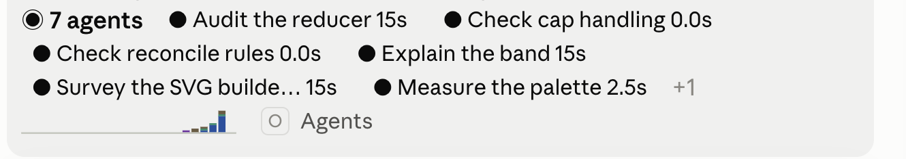
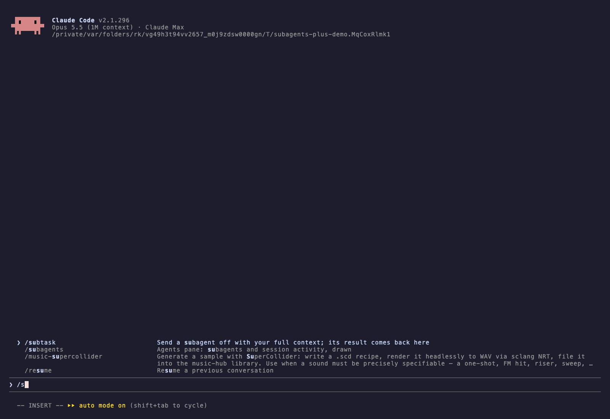

# subagents-plus

[](https://github.com/algonormative/subagents-plus/actions/workflows/ci.yml)
[](https://github.com/algonormative/subagents-plus/releases/latest)
[](LICENSE)
[](#install)
[](https://code.claude.com/docs/en/plugins/mods/overview)
[](#install)

See what your subagents are doing. A Claude Code mod that adds a `/subagents` pane:
a live, expandable tree of every subagent in the session, nested under the agent
that spawned it. It also adds a card on each Agent tool row and a band above the
prompt while agents run.

<p align="center"></p>

| Transcript in the pane | Timeline |
|---|---|
|  |  |

| Card on an Agent row | Band above the prompt |
|---|---|
|  |  |

<sub>Screenshots from the Claude desktop app, light theme. The pane, band and cards also draw in a terminal session.</sub>

**In a terminal session** the pane docks beside the transcript ([demo/demo.tape](demo/demo.tape) records this with [VHS](https://github.com/charmbracelet/vhs)):



- **Agents tree.** Every subagent nested under its parent, and workflow agents grouped under their workflow. Each row shows:
  - status, with the name gently pulsing while the agent runs
  - type and model
  - elapsed time, tool calls and tokens
  - a live line saying what the agent is doing right now: the tool it is in and for how long, or the tail of what it is writing or thinking
- **Expand a row** for:
  - its token breakdown, with cache reads counted apart
  - its tool mix and recent calls
  - its final answer
  - its transcript, read in the pane
- **Timeline.** Swimlanes of tool calls (colored by kind) and model time per agent. The agent buttons under it open an agent in the tree.
- **Agent-row cards** (desktop app). Each Agent call in the transcript gets a live card: status, model, a strip of its tool calls, and counts. The engine's own row stays underneath.
- **Band above the prompt.** While subagents run it shows each agent with its elapsed time and a two-minute activity sparkline. It closes 10 seconds after the last one finishes.

Nested subagents are supported to any depth. The engine allows 3 levels by default; raise it with `CLAUDE_CODE_MAX_SUBAGENT_SPAWN_DEPTH`.

## Install

Add the marketplace once, then install from it:

```
/plugin marketplace add algonormative/claude-plugins
/plugin install subagents-plus@algonormative
```

Or install it from this repository alone:

```
/plugin install subagents-plus --marketplace algonormative/subagents-plus
```

Type these at the prompt of a terminal `claude` session (answer `y` to add the marketplace, then pick a scope). A mod installed at the user scope also loads in the desktop app's Code tab. Outside a session the same works as `claude plugin marketplace add …` and `claude plugin install …`.

Requires a Claude Code build with function-hook mods (2.1.295 or newer). The mod API is early access and may change between releases.

## Use

- `/subagents` opens the pane. It also opens on its own when the first subagent of a session spawns, where the pane can dock beside the transcript.
- **Tabs:** press `1` for Agents and `2` for Timeline.
- **In the tree:** click a name to expand it, and click `▾` to fold an agent's children.
- **Inside an expanded agent:**
  - *Activity* and *Transcript* switch what it shows.
  - *Show in conversation* scrolls the transcript to the agent's Agent row. In the desktop app, clicking that row opens the app's own subagent view. A mod can't switch the main transcript itself.
- **Other commands:**
  - `/subagents tree` and `/subagents timeline` open the pane on that tab.
  - `/subagents clear` forgets finished agents.
  - `/subagents close` closes the pane.

## Options

Set them with `/plugin configure subagents-plus@algonormative`. They are stored under `pluginConfigs` in `~/.claude/settings.json`.

| Option | Default | What it does |
|---|---|---|
| `autoOpen` | `true` | Open the pane when the first subagent spawns, where it docks beside the transcript |
| `inlineCards` | `desktop` | Live cards on Agent rows: `desktop`, `all` (terminal too) or `off` |
| `band` | `true` | The band above the prompt while subagents run |
| `streamTap` | `subagents` | Time each model request for subagents (`subagents`), every loop (`all`), or not at all (`off`). The tap also feeds the live "writing / thinking" line |
| `animate` | `true` | Pulse running agents |
| `diagnostics` | `false` | Register a read-only `status` tool the model can call to report what the mod sees and draws. A development aid |

## How it works

Hooks on `agent.spawn`, `tool.call`, `turn.start`, `turn.step` and `turn.complete` push small events into a buffer. Every 400 ms a pure reducer (`hooks/model.ts`) folds them into session state:

- **Lanes:** one lane per agent.
- **Spans:** one span per tool call.
- **Steps:** one step per model request.

`$.agent.list()` is checked every 2 seconds, so an agent whose end was missed is still closed. Nothing is sent anywhere and nothing calls a model.

Tokens are counted once per turn, from `turn.complete`; per-request figures stand in only while a turn is running. Cache reads are reported apart from fresh tokens, because summed over many requests they would dwarf everything else.

## Develop

```
claude --plugin-dir .            # run a session with the mod loaded from this folder
claude plugin validate .         # what the engine will load, hook and refuse
claude plugin test .             # the *.test.ts(x) files (no network, no model calls)
```

On first load the engine writes its API types to `.claude-plugin/types/` (git-ignored), so `tsc -p .` type-checks the mod after that.

Releases: bump `version` in `.claude-plugin/plugin.json`, add a `CHANGELOG.md` section, then tag `v<version>`. GitHub Actions validates, tests and publishes the release. Installs update through `/plugin update` (or the marketplace's auto-update) once the version changes.

### Re-record the demo

`demo/demo.tape` records `demo/terminal.gif` with [VHS](https://github.com/charmbracelet/vhs) in your own logged-in `claude`. To keep your other plugins out of the recording, give it a settings file that turns every installed plugin off except this one:

```bash
python3 - > /tmp/subagents-plus-demo-settings.json <<'EOF'
import json, os
s = json.load(open(os.path.expanduser("~/.claude/settings.json")))
on = {n: n.split("@")[0] == "subagents-plus" for n in s.get("enabledPlugins", {})}
out = {"enabledPlugins": on, "theme": "dark", "statusLine": {"type": "command", "command": "true"}}
print(json.dumps(out))
EOF
DEMO_DIR="$(demo/setup.sh)" DEMO_SETTINGS=/tmp/subagents-plus-demo-settings.json vhs demo/demo.tape
```

The settings file only switches plugins for the recording; your own `settings.json` is untouched. Look through the GIF before you publish it: anything your session prints (paths, task titles) ends up in it.

## License

MIT
